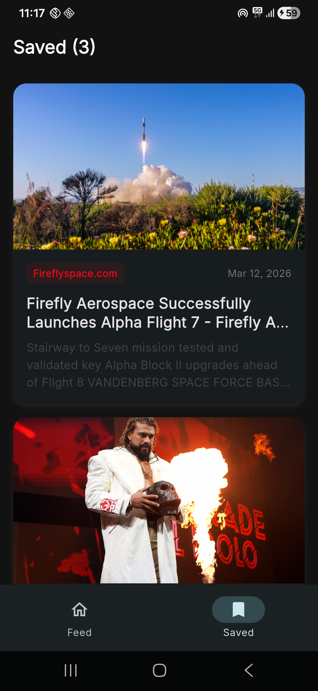
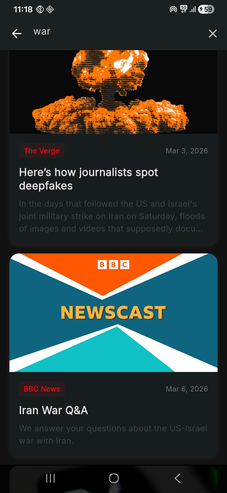
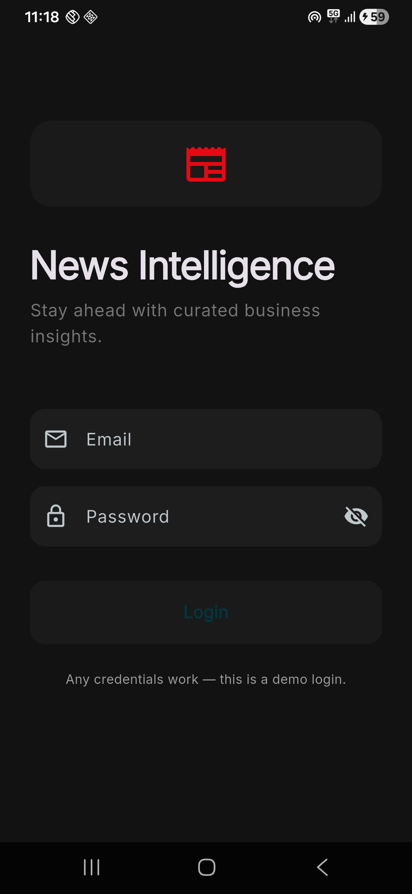

<h1 align="center">📰 News Intelligence</h1>

<p align="center">
  A clean, modern Flutter news app powered by <a href="https://newsapi.org">NewsAPI.org</a>.<br/>
  Built with Clean Architecture · Riverpod · Hive · Material 3
</p>

<p align="center">
  
  
  
  
  
</p>

<p align="center">
  <em>Login &nbsp;·&nbsp; News Feed &nbsp;·&nbsp; Search &nbsp;·&nbsp; Saved Articles &nbsp;·&nbsp; Article Detail</em>
</p>

---

## ✨ Features

| Screen | What it does |
|---|---|
| **Login** | Demo login with any credentials · session persisted via Hive |
| **News Feed** | Category tabs — Business, Technology, Science, Health, Entertainment, Sports |
| **Infinite Scroll** | Lazy-loads more articles as you scroll |
| **Pull-to-Refresh** | Swipe down to fetch the latest headlines |
| **Search** | Full-text search using NewsAPI's `/everything` endpoint |
| **Article Detail** | Hero image · author · content preview · bookmark · open in browser |
| **Favourites** | Offline bookmarks stored in Hive · swipe-to-delete |
| **Dark Mode** | System-adaptive Material 3 theming with Inter font |

---

## 📸 Screenshots

| Login | News Feed | Search | Saved | Article Detail |
|:---:|:---:|:---:|:---:|:---:|
|  |  |  |  |  |

---

## 🏗 Architecture

The project follows **Clean Architecture** with a **Feature-First** folder layout.

```
lib/
├── core/
│   ├── error/          → Failure base classes (Server, Cache, Network, Auth)
│   ├── network/        → Singleton Dio provider (base URL + interceptors)
│   ├── navigation/     → HomeShell — bottom navigation scaffold
│   └── theme/          → AppTheme — Material 3 light & dark themes
│
└── features/
    ├── auth/
    │   └── presentation/
    │       ├── providers/   auth_provider.dart   (Riverpod Notifier · Hive)
    │       └── screens/     login_screen.dart
    │
    ├── news/
    │   ├── domain/models/   article.dart         (pure Dart entity)
    │   ├── data/repositories/ news_repository.dart (Dio + NewsAPI)
    │   └── presentation/
    │       ├── providers/   news_provider.dart   (AsyncNotifier · pagination)
    │       ├── screens/     news_feed_screen.dart · article_detail_screen.dart · search_screen.dart
    │       └── widgets/     article_card.dart
    │
    └── favorites/
        └── presentation/
            ├── providers/   favorites_provider.dart (Notifier · Hive)
            └── screens/     favorites_screen.dart
```

### Key Design Decisions

- **Riverpod 2** — `Notifier` / `AsyncNotifier` with `riverpod_generator` for zero-boilerplate providers.
- **Hive CE** — lightweight key-value persistence for auth state and offline favourites (no type adapters needed — stored as JSON maps).
- **Dio** — typed HTTP client with `LogInterceptor` and 10-second timeouts; repository wraps all calls in try/catch.
- **Infinite scroll** — `ScrollController` triggers `NewsFeed.loadMore()` 200 px before the bottom; next page computed as `(articles.length / 20).ceil() + 1`.
- **`IndexedStack`** in `HomeShell` keeps tab state alive across bottom-nav switches (no re-fetching).

---

## 🚀 Getting Started

### Prerequisites
- Flutter ≥ 3.11.0
- A free API key from [newsapi.org](https://newsapi.org)

### 1 · Configure your API key

Open `lib/features/news/data/repositories/news_repository.dart` and replace the key:

```dart
static const _apiKey = 'YOUR_NEWSAPI_KEY_HERE';
```

### 2 · Install & run

```bash
flutter pub get
dart run build_runner build --delete-conflicting-outputs
flutter run
```

### 3 · Login

Enter **any** non-empty email and password — this is a demo authentication. Your session persists across app restarts.

---

## 📦 Dependencies

| Package | Role |
|---|---|
| `flutter_riverpod` | Reactive state management |
| `riverpod_annotation` + `riverpod_generator` | Code-generated providers via `@riverpod` |
| `dio` | HTTP client for NewsAPI |
| `hive_ce` + `hive_ce_flutter` | Local offline storage |
| `cached_network_image` | Disk-cached image loading |
| `google_fonts` | Inter typeface |
| `intl` | Date formatting (`DateFormat.yMMMd`) |
| `url_launcher` | Open articles in the system browser |
| `freezed_annotation` + `json_annotation` | Immutability & serialization annotations |
| `shimmer` + `flutter_spinkit` | Loading UX utilities |

---

## 📡 API

| Endpoint | When used | Key params |
|---|---|---|
| `GET /top-headlines` | Category feed | `category`, `language=en`, `page`, `pageSize=20` |
| `GET /everything` | Search | `q`, `page`, `pageSize=20` |

Base URL: `https://newsapi.org/v2/`

---

## 📂 Assets

```
assets/
└── images/
    ├── flutter_01.png   ← Login screen
    ├── flutter_02.png   ← News feed (category tabs)
    ├── flutter_03.png   ← Search screen
    ├── flutter_04.png   ← Saved / Favourites screen
    └── flutter_05.png   ← Article detail view
```

---

## 📝 Developer Reference

See [`developers.md`](developers.md) for a full file-by-file code walkthrough, data-flow diagrams, and code-generation instructions.

---

<p align="center">Made with ❤️ in Flutter</p>
